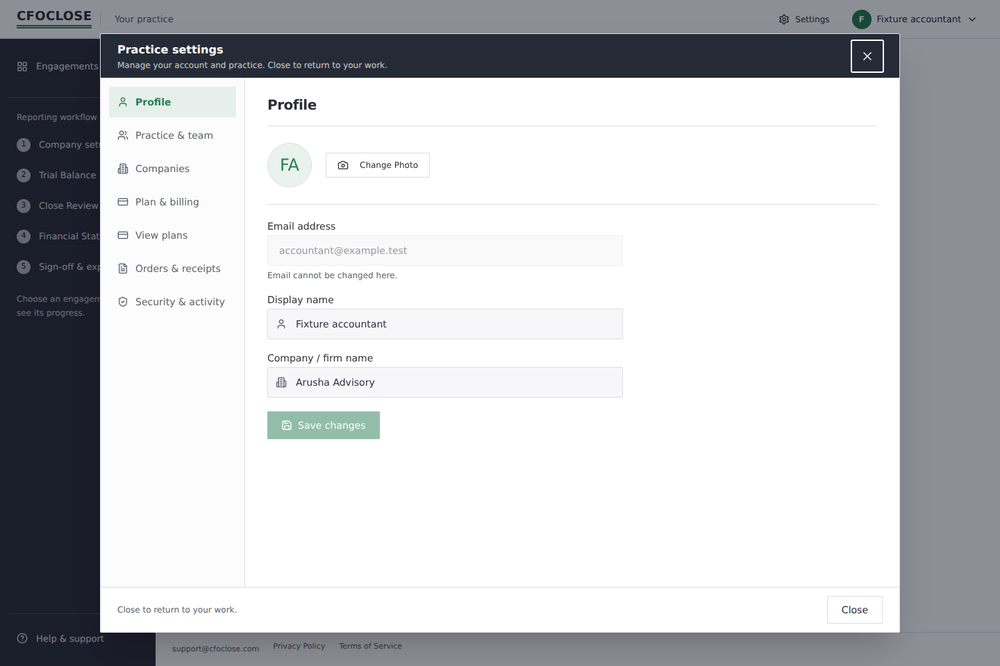
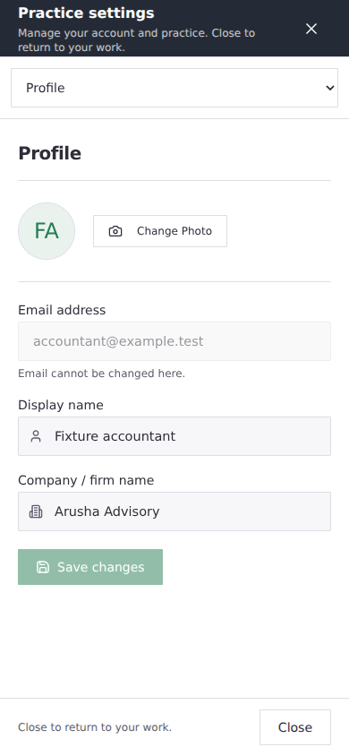

# Practice management window and portfolio

## Customer behaviour

Opening Settings from the account or workspace header keeps the original workspace mounted behind one management window. The window has a persistent title, a 44 px close target, a footer Close action, desktop section navigation and a mobile section selector. Settings, plans and orders share that window. Direct management links have an explicit exit to Engagements. Signed-out plan discovery remains a public page.

Companies appear immediately, with creation and editing inside the management window. Team members and invitations are separate tables; composing an invitation stays in the same window. Company metadata uses the existing canonical framework choices. Selecting a framework records metadata only: it does not enable statement generation or grant reporting access.

The portfolio shows Company, Period, Status and Next action initially. Search stays visible. Filters and optional columns are progressive controls. Needs attention sends the existing multi-status filter to the server across the entire portfolio; it does not sort only the current page or invent a new priority order. Test and training purposes are explicit on each labelled row. A single page has no pagination controls. Accepted is qualified as Trial balance accepted. A blocking status has a truthful general explanation; the existing portfolio contract does not return a particular finding or imbalance amount, so none is fabricated.

## Navigation and edits

| Action | Behaviour | Verification |
| --- | --- | --- |
| Header opens management | The original company, period, URL query/hash and mounted draft remain behind the window | Component regression plus isolated Chromium journey |
| Close, X or Escape | Same route-backed dismissal, then focus returns to the opening control | Component and browser journeys |
| Unsaved profile, company, invitation or team selection | Explicit keep/discard choice; a failed save retains the edit | Shared edit registry, routed regression; inline form confirmation |
| Browser Back while dirty | The data router blocks navigation and requires keep/discard | Real router component regression |
| Save, removal or access update in progress | Navigation cannot treat it as cancelled or discard it; the result must finish | Busy-state regression; existing server writers retained |
| Direct link/reload | Management has a visible exit even with no previous workspace | Component regression |
| Plans/orders/tab changes | Preserve the first workspace origin; checkout remains a separate consequential flow | Component and browser journeys |
| Company field-lock response arrives after another selection | The outdated response cannot unlock the new company's fields | Request sequence fence |
| Slow profile/order read after leaving or changing identity | Outdated responses do not replace the new screen's state | Read cancellation/sequence fence |

Only one route blocker owns management navigation. Individual editors register dirty/busy state with that boundary. This state is transient UI state; no financial drafts are stored in browser persistence. Dismissal does not create, retry or cancel a server operation. Existing permissions, capacity, sign-off, report, payment and transaction boundaries remain authoritative.

The account's portfolio remains server-paged with its existing keyset cursors and change token. No SQL, RLS, entitlement, provider or deployed function change is required by this PR. This change does not assert hosted release verification or a live payment.

## Evidence

- `ManagementWindow.test.ts`: workspace preservation, complete route identity, Escape/Close, discard and keep, browser Back, in-flight protection, direct links, origin validation and axe checks.
- `EngagementPortfolio.test.ts`: existing pagination/view-token/access cases plus collapsed controls, one-page pagination suppression, server-wide attention filtering and precise acceptance/training labels.
- `scripts/e2e/paymentJourney.mjs`: the existing real-stack journey now tests management exits and an unsaved profile edit without saving it; it retains header keyboard-focus assertions after closing management.
- Isolated Chromium visual review: actual management, Settings, Companies, team and orders components with invented data and external requests blocked; desktop 1440×960 and mobile 390×844. The mobile window fits the viewport and retains the X. This harness is temporary and is not shipped.

