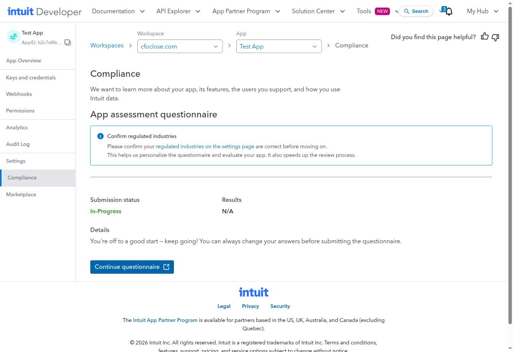

# Live readiness acceptance — 3 November 2026

Status: incomplete. Customer switch remains off. No Lovable AI request was sent for this test/fix.

## Browser evidence

Signed into CFOClose and Intuit through secure credential forms. Created a separate empty company, **CFOClose QBO Readiness Acceptance 20261103**, company `8e206ec2-8890-4979-b2ff-8f5a18c56f77`, FY2026 January–December USD. Starting Trial Balance Review persisted its engagement/period. Existing source files were not replaced.

The internal tester excluded nonempty companies, required a sample-data acknowledgement, and opened the normal import card. Existing Intuit access to Sandbox Company US 9355 was reused; no new consent screen was presented. OAuth callback/finish returned to CFOClose with connected realm `9341458604136919`.

The first import refused with “The saved reporting dates could not be confirmed.” Using Settings → Reporting period → Set up the period returned successfully, but a retry still refused. A read-only hosted query confirmed period `3d1deebb-dfa5-46f9-bb8f-8d556da388e7` retained `dates_basis=company_year_end`. This is a reproducible UI/server handoff defect, not a vendor report mismatch. No successful new import or source comparison is claimed.

## Forward fix

PeriodSetup now calls the existing audited `confirm_period_dates` after opening/reusing the period and before reporting success or navigating away. An explicit refusal keeps the form and entered dates. A lost/invalid response cannot be treated as success; the client requires the exact `confirmed` outcome and matching period identity. Both RPCs retain their existing authorization, locking and idempotency contracts. No SQL or privilege change, and no direct table write or backend bypass.

The operations remain separate transactions: opening/linking an engagement can succeed before confirmation refuses. The UI does not claim completion in that case; a retry reuses the engagement and the idempotent confirmation. This is not a claim that the two operations are atomic.

Regression tests exercise delayed confirmation, processing refusal, wrong identity and unexpected outcome. Local focused suite: 41 passed; TypeScript and targeted lint passed. Full-suite/CI results belong to the PR, not this historical record.

The first full-suite run also exposed missing release bookkeeping on main after Lovable created mirror `0101_qbo_readiness_controls.sql`: it was not yet registered in RELEASE_JOURNAL. This follow-up pins its byte-identical 20,040-byte installed receipt with the independently observed hosted id 102 hash, and updates the exact installed/pending fixtures. A tampered-mirror test preserves fail-closed parity. Installed source/mirror/journal history is not edited or replayed.

## Intuit production preparation

The existing app is **Test App**, app ID `b2c7e8fe-a561-4999-a525-200c55d16ef8`, workspace `cfoclose.com`. It was Pending, and assessment was blocked on industry selection. Saved **None of the above** for the listed insurance/securities/lending/payment-movement activities, consistent with the read-only reporting integration; charging for the software itself is not the described customer-to-customer payment API activity. Started assessment; portal now reports **In-Progress**, results **N/A**. No assessment submission, acceptance of new legal terms, production-key generation/configuration or customer activation occurred.

Owner facts are still needed for regulatory complaints/investigations, legal counsel review, sanctions exposure, prior reportable security breaches and security-team arrangements. Security-policy compliance and data/AI handling require evidenced answers; disabled AI functionality must not be represented as nonexistent without considering the whole app. No unknown declaration was answered on the owner's behalf.

## Remaining acceptance

Deploy the frontend fix after exact-head CI, then rerun the normal period confirmation/import and independently compare the source report. The existing US realm is shared with the original sandbox company: do not revoke its app grant as a shortcut. Verify shared-realm refusal and use a separate Intuit sandbox realm for a complete upstream disconnect/reconnect test. The new test connection has not been disconnected. Inspect current provider state before any further connection changes.

Finish truthful production assessment with owner facts and action-time legal/access consent where required; obtain Intuit approval and securely configure distinct production credentials. Only then consider customer activation. Backup evidence and deployed-source attestation limitations from the installation report remain unresolved.
